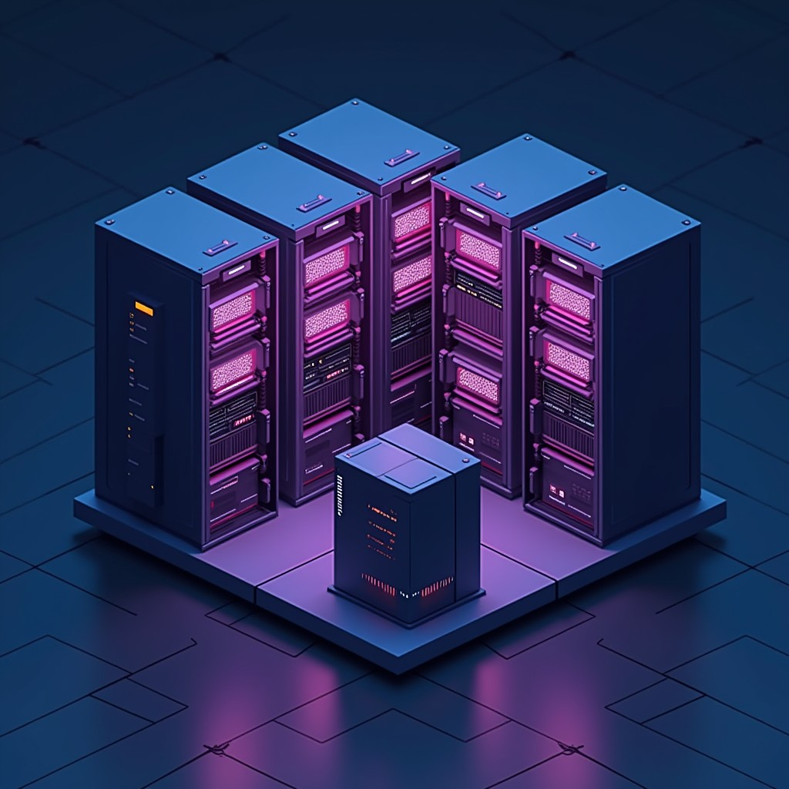

# FLUX.1-dev on Runpod Serverless

A Runpod Serverless endpoint that turns a text prompt into an image with
[FLUX.1-dev](https://huggingface.co/black-forest-labs/FLUX.1-dev). The model is baked into the
Docker image. The worker, the clients, deployment as code and a benchmark are all in one Python
package, with one command-line tool, `flux-endpoint`.

Start with the Runpod handler in
[`src/flux_endpoint/worker/handler.py`](src/flux_endpoint/worker/handler.py). The image builds
from the [`Dockerfile`](Dockerfile), and the endpoint settings are in
[`deploy/endpoint.toml`](deploy/endpoint.toml).

## What it does

- Serves FLUX.1-dev on Runpod Serverless and returns each image as base64 or as a presigned
  URL.
- Takes the same request fields as Runpod's FLUX.1-dev Public Endpoint, so a client that sends
  `guidance` can switch between the two. The CLI reads the image field of either.
- Deploys the endpoint as code on the Runpod REST API v2 and verifies every setting after the
  write.
- Measures latency and cost per image on each GPU type, and the traffic level at which a
  dedicated worker becomes cheaper than the Public Endpoint.
- Compares cold starts for the model baked into the image, as a Runpod cached model, and on a
  Global Volume.
- The worker runs as a non-root user. Dependencies are pinned and audited.
- Clients retry with backoff and put a time limit on every job.
- Line and branch coverage is 100%, and CI fails below 90%.

## Results

| | |
|---|---|
|  |  |
|  |  |

Measured on 19 October 2026:

- An L40S made a 1024 x 1024 image with 28 steps in 15.7 seconds for $0.0076, and an A100 in
  12.8 seconds for $0.0096.
- The Public Endpoint charged $0.012 per image and queued for 11.2 seconds at the median, with
  5 jobs in flight. At the flex price, a dedicated GPU was cheaper only above 63% utilization.
  On a dedicated GPU, the median queue time was 0.4 seconds or less.
- A full cold start took 22 to 24 seconds at the median with the model in the image or as a
  Runpod cached model, and 6 minutes from a Global Volume. FlashBoot cut 3 of 5 restarts to
  about 1 second.

See [Results](docs/results.md) for every GPU type, the scale-out test, the cold starts and the
platform findings.

## Try it

The first way runs on a laptop with no account, and the last is a full build. The steps for
all four are in [Try it](docs/try-it.md).

| Way | Needs |
|---|---|
| On a laptop, with a tiny test model on the CPU | [uv](https://docs.astral.sh/uv/) and jq |
| Call the live endpoint, with Postman, the CLI or curl | An API key and endpoint ID from the endpoint owner |
| Deploy in your own Runpod account, from the public slim image and a Runpod cached model | A Runpod API key and a Hugging Face token |
| Build everything from source | Also a private container registry |

## Quick start

To try the worker without an account, run it on your laptop with a tiny test model on the
CPU. You need [uv](https://docs.astral.sh/uv/) 0.12 or later and jq, on Linux or on a Mac with
Apple silicon and macOS 14 or later. Clone the repository and install:

```bash
git clone https://github.com/SaadAmer/flux-endpoint.git
```

```bash
cd flux-endpoint && make install
```

The install pulls in PyTorch and the worker libraries, roughly 230 MB on a Mac and 3.1 GB on
Linux. To call an endpoint without running the worker, `uv sync --extra client` is enough (see
[Try it](docs/try-it.md)). Then start the worker:

```bash
make worker-local
```

The tiny model has random weights, so the image will be noise. Once the worker logs
`Uvicorn running on http://localhost:8010`, open another terminal in the same folder and send
a job:

```bash
curl -s -X POST http://localhost:8010/runsync -H "Content-Type: application/json" -d @test_input.json | jq -r '.output.image_base64' | base64 --decode > local.png
```

## Deploy on Runpod

To deploy in your own Runpod account without a build, use the public slim image, as in way 3
of [Try it](docs/try-it.md).

To build the image with the weights and deploy it, you need Docker with buildx, a Hugging Face
token that can read FLUX.1-dev in `~/.cache/huggingface/token`, and a private Docker Hub
repository. Create that repository as private before the first push, because a push to a
missing repository creates it with the account's default visibility. The weights must not be
published. Run `docker login`, set `RUNPOD_API_KEY`, `DOCKERHUB_USERNAME` and a read-only
`DOCKERHUB_TOKEN`, then point the build at your repository:

```bash
export IMAGE="docker.io/$DOCKERHUB_USERNAME/flux-endpoint"
```

```bash
make image
```

```bash
make deploy
```

Set `RUNPOD_ENDPOINT_ID` to the ID from the deploy output, then generate an image:

```bash
uv run flux-endpoint generate "A lighthouse on a rocky coast at dusk, cinematic lighting" --seed 42
```

Remove the endpoint when you finish:

```bash
make teardown
```

More detail on each step is in [Deployment](docs/deployment.md).

## How it works


The client queues a job on the Runpod job API. When jobs are waiting, the scaler starts a GPU
worker, which loads FLUX.1-dev once and then validates each request, generates the image and
returns it with the seed and timings. The client reads the result and cancels any job it stops
waiting for. See [Architecture](docs/architecture.md) for each stage in detail, including the
image build and the worker lifecycle.

## Documentation

| Guide | Covers |
|---|---|
| [Try it](docs/try-it.md) | Running it on a laptop, against the live endpoint, or in your own account |
| [Architecture](docs/architecture.md) | Components, request path and worker lifecycle |
| [Deployment](docs/deployment.md) | Build, deploy, update, roll back, remove |
| [API](docs/api.md) | Request and response fields, with curl, Python, CLI and Postman examples |
| [Operations](docs/operations.md) | Monitoring and troubleshooting |
| [Design](docs/design.md) | Design rationale and scaling |
| [Security](docs/security.md) | Threats and controls |
| [Development](docs/development.md) | Setup, tests and standards |
| [Results](docs/results.md) | Measurements, and how to repeat them |

## License

The code is under the [MIT License](LICENSE). FLUX.1-dev has its own
[FLUX.1 [dev] Non-Commercial License](https://huggingface.co/black-forest-labs/FLUX.1-dev/blob/main/LICENSE.md).
The image with the weights is pushed only to a private registry, with a copy of that license
next to the weights. The public slim image holds no weights.
